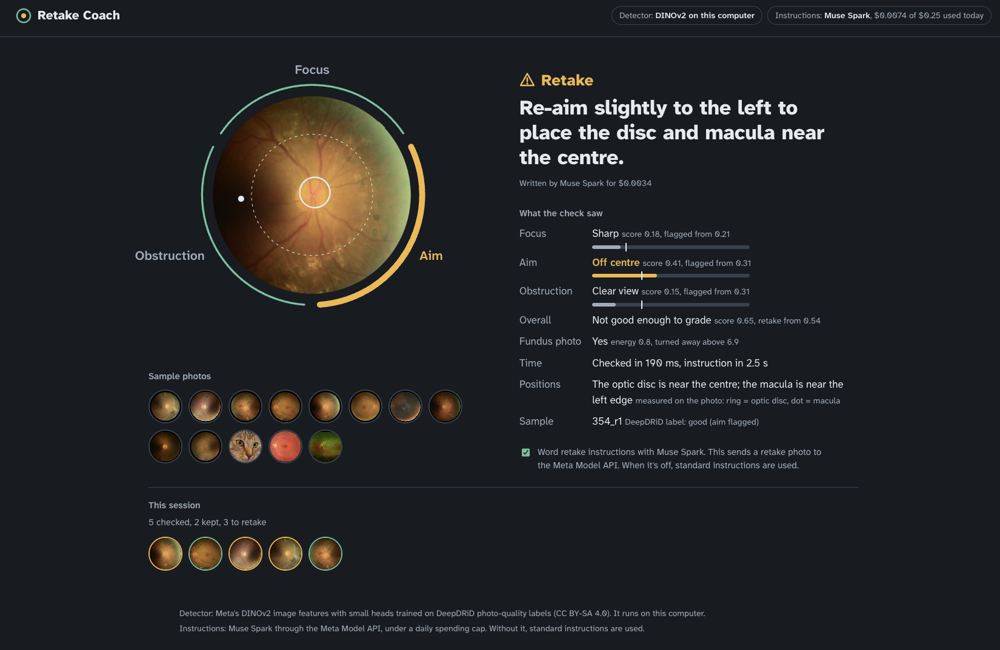

# Retake Coach

Catch an ungradable fundus photo while the patient is still in the chair.

In diabetic eye screening, a technician photographs the retina and sends the photos on to be graded. When a photo is
too blurry, badly aimed or partly covered, nobody can grade it, and the patient has to come back. This happens often.
In a US telehealth program, 12.4% of eyes photographed with a non-mydriatic camera were ungradable
([Silva et al., *Diabetes Care* 2014](https://doi.org/10.2337/dc13-1292)). With a handheld non-mydriatic camera in
India, 23.9% of images were ungradable
([Davila et al., *Ophthalmologica* 2017](https://pmc.ncbi.nlm.nih.gov/articles/PMC5733780)).

Retake Coach checks each photo in about a second, on the computer next to the camera. It says **keep** or **retake**.
For a retake, it says what to fix: focus, aim, or something blocking the view. For aim, it measures where the optic
disc and macula are and says which way they are off. It turns away pictures that are not regular fundus photos,
such as a widefield image or the wrong file.

It checks photo quality only. It does not look for disease and gives no medical advice.



## How it uses Meta models

| Job | Meta model | Runs | Cost |
|---|---|---|---|
| Detect focus, aim and obstruction problems, and overall gradability | **DINOv2** (`facebook/dinov2-base`, frozen) plus four small logistic heads | on the local computer | $0 |
| Turn away inputs that are not regular fundus photos | **DINOv2** features plus a Gaussian energy (Mahalanobis distance) fitted on ordinary fundus photos only | on the local computer | $0 |
| Measure where the optic disc and macula are, so aim directions are never guessed | **DINOv2** patch tokens plus a ridge map to two heatmaps | on the local computer | $0 |
| Word the instruction for the technician | **Muse Spark 1.3** through the Meta Model API, with `reasoning_effort="minimal"` | cloud, under a daily dollar and request cap | about $0.002 per retake |

Detection happens on the camera's computer. A photo goes to the Meta Model API only when a retake is needed and the
Muse Spark budget allows it. Past the cap, or on any error, fixed instructions are used.

Muse Spark is not the detector, by design. In a 20-photo pilot it asked for a retake on 4 of 5 good photos and named
almost every problem on every photo ([results/muse_coach_pilot.csv](results/muse_coach_pilot.csv)). Its wording was
good, though. It also put the macula on the wrong side of a photo when asked for an aim direction
([results/muse_wording_pilot.csv](results/muse_wording_pilot.csv), photo 354_l1). So the tool splits the jobs:
- **The heads** decide whether there is a problem.
- **The locator** says where the disc and macula are.
- **Muse Spark** only phrases the result, using the measured positions as facts.

## Results on photos the model never trained on

**DeepDRiD test set** (400 photos, patients separate from training and validation). Every threshold and setting was
chosen on validation photos. The retake threshold sends back at most 25% of good *validation* photos, a limit set
before the test set was scored. ([results/final_model_report.txt](results/final_model_report.txt))

| Check | AUROC (95% CI) | Sharpness alone |
|---|---|---|
| Focus (clarity ≤ 6) | 0.90 (0.87–0.93) | 0.88 |
| Aim (field definition ≤ 6) | 0.85 (0.80–0.90) | 0.53 |
| Obstruction (artifact ≥ 6) | 0.95 (0.92–0.96) | 0.85 |
| Overall "not good enough for diagnosis" | 0.82 (0.78–0.86) | 0.74 |

- **Retake decision:** it catches 74% of not-good-enough photos (162 of 220) and sends back 23% of good ones (42 of 180).
- **Naming:** on caught photos with a labelled problem, the first problem it names is a real one 89% of the time.
  By problem: focus-only 100% (26), aim-only 89% (18), obstruction-only 30% (10). Obstruction is the weak spot.
- **Another hospital:** heads trained on one DeepDRiD hospital score AUROC 0.75–0.93 on the other two
  ([results/first_build_report.txt](results/first_build_report.txt), section 2).
- **Another camera:** on IDRiD photos (India) that were picked for grading, it asks for a retake on 9%.
- **Guard:** it accepted 100% of fundus photos from DeepDRiD, IDRiD and the web. It turned away 100% of DeepDRiD
  widefield photos and of everyday pictures plus a black frame. Fundus photos score an energy of 1–7; everything
  else scored 26–210.
- **Disc and macula positions** on IDRiD's 103 held-out photos: median error 0.08 disc diameters for both, all within
  1 disc diameter of the experts' marks. A brightest/darkest-spot baseline gets 0.21 for the disc and 0.82 for the
  fovea ([results/locator_report.txt](results/locator_report.txt), [figure](results/locator_examples.png)).

**Limits, plainly:**
- **Noisy labels.** DeepDRiD's own labels disagree with each other. 34% of photos graded good enough have a problem
  in their sub-scores, and 36% of not-good-enough photos have none. That limits any detector scored against the
  overall label.
- **The test set was scored twice:** once with the first heads ([results/first_build_report.txt](results/first_build_report.txt))
  and once with the final ones. All choices were made on validation photos.
- **Field definition scores follow measured positions only loosely** (AUROC 0.66). Read literally, DeepDRiD's top
  score asks for disc and macula within 1 disc diameter of the centre, but the two sit about 2.5 disc diameters
  apart. So the aim head decides *whether* aim is off, and the locator only says *which way*. If the locator finds
  both near the centre, the instruction falls back to standard wording.
- **Training data comes from one dataset** (three hospitals). On synthetically damaged IDRiD photos, it often named
  focus for shadows and crops. Synthetic damage is a weak stand-in for real problems, but it is a reason to check a
  new camera before relying on the tool.

## Run it

**In Colab** (what the demo video uses). Put the notebooks' data in a Drive folder `MyDrive/ebl_fundus/`, including
the IDRiD zips (*A. Segmentation*, *B. Disease Grading*, *C. Localization*). Then run in order:

1. `notebooks/1_quality_energy_test.ipynb`: caches DINOv2 features for the DeepDRiD training and validation photos.
   It also holds the zero-shot energy experiment, which did not beat a sharpness check.
2. `notebooks/2_muse_coach_pilot.ipynb`: Muse Spark as a judge. Capped at 20 requests and $0.25. Optional.
3. `notebooks/3_retake_coach_build.ipynb`: test, IDRiD, widefield and everyday-picture features, and the first report.
4. `python scripts/final_model.py --features quality/features.npz --build quality/build_features.npz --labels Challenge2_labels.xlsx`:
   the final heads, thresholds and guard. This needs no GPU or API.
5. `notebooks/4_aim_locator_build.ipynb`: the disc and macula locator.
6. `notebooks/5_run_demo.ipynb`: starts the page and prints a link. Muse Spark is capped at $0.25 a day and $1 in total.

**Locally:**

```bash
pip install -r requirements.txt
export MODEL_API_KEY=...        # optional; without it the page uses standard instructions
python app.py                   # http://127.0.0.1:8000, uses models/coach_model.npz and models/locator.npz
```

`MUSE_DAILY_USD`, `MUSE_DAILY_REQUESTS` and `MUSE_TOTAL_USD` set the caps (defaults $0.25, 60 and $1.00).
Put sample photos in `examples/`, with an optional `labels.json` of notes, to get a row of samples on the page.

## Built during the event

Everything in this repository was built during the hackathon (Oct 26 – Nov 4, 2026). One exception: the
experiments in `experiments/` that retrain a diabetic-retinopathy grader use training code from our earlier
IntelliSys 2026 paper. That code is not included or needed for Retake Coach. See
[experiments/README.md](experiments/README.md) for the directions we tried first, with their results, including what
did not work.

Total Meta Model API spend for the whole event, experiments included, was under $3.

## Data and licences

- **DeepDRiD** ([github.com/deepdrdoc/DeepDRiD](https://github.com/deepdrdoc/DeepDRiD), CC BY-SA 4.0): photo-quality
  labels for training and testing, plus widefield photos for the guard.
- **IDRiD** ([idrid.grand-challenge.org](https://idrid.grand-challenge.org/Data/), CC BY 4.0;
  [Porwal et al. 2018](https://dx.doi.org/10.21227/H25W98)): expert-marked disc and fovea centres, and a second camera.
- **scikit-image** sample pictures for the guard's everyday-picture check.

No images are stored in this repository except the two result figures, which show DeepDRiD and IDRiD photos under
their licences. `models/` holds weights fitted on these labels; see [models/README.md](models/README.md).
